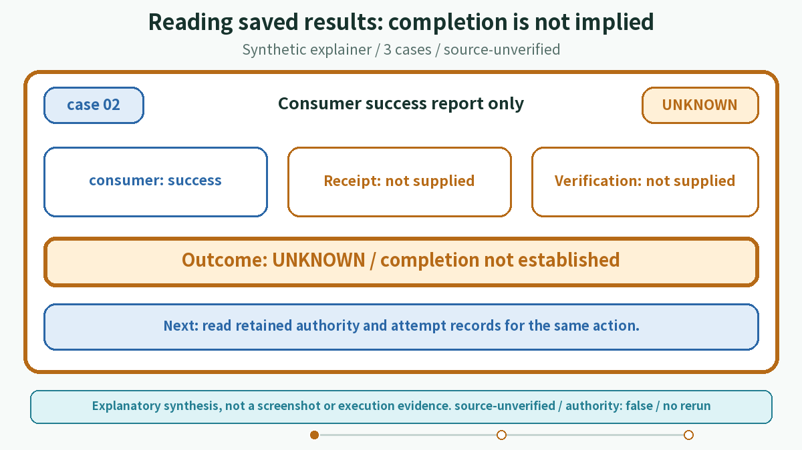
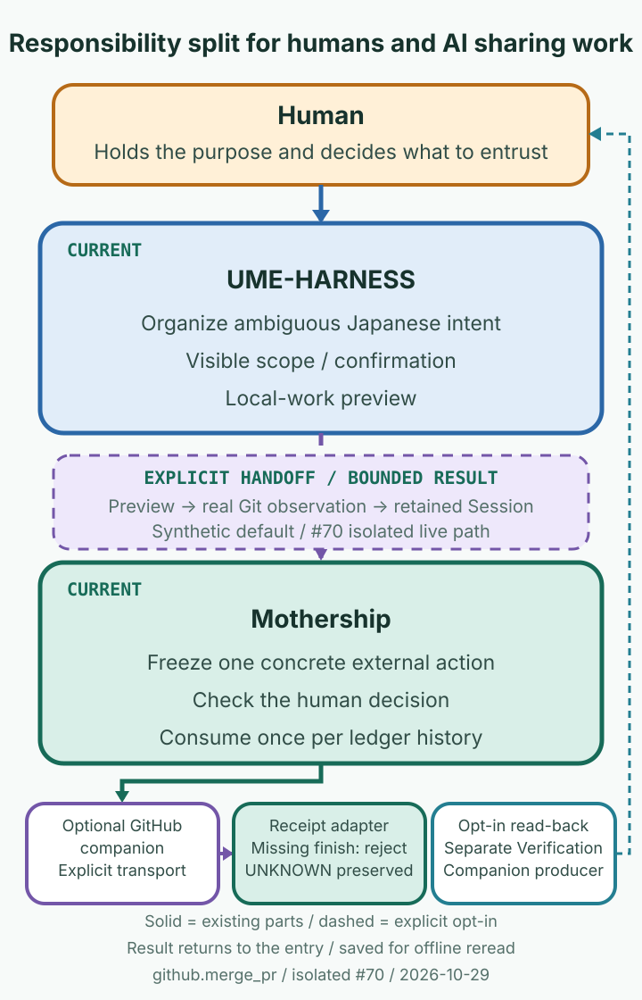
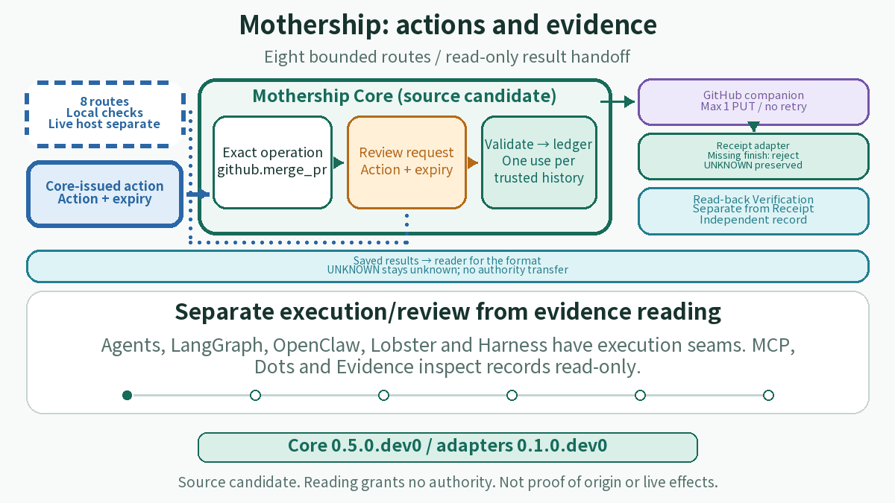
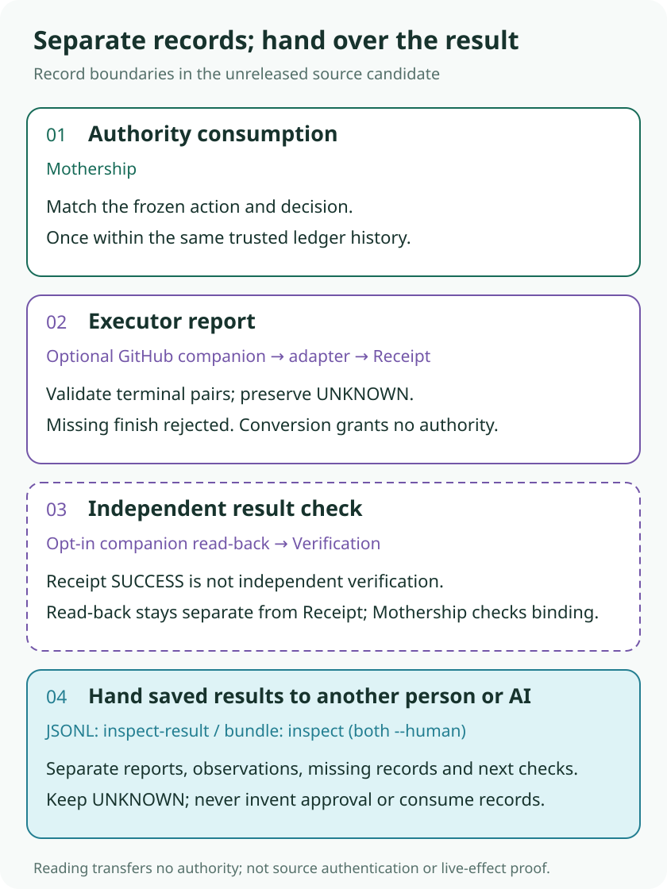
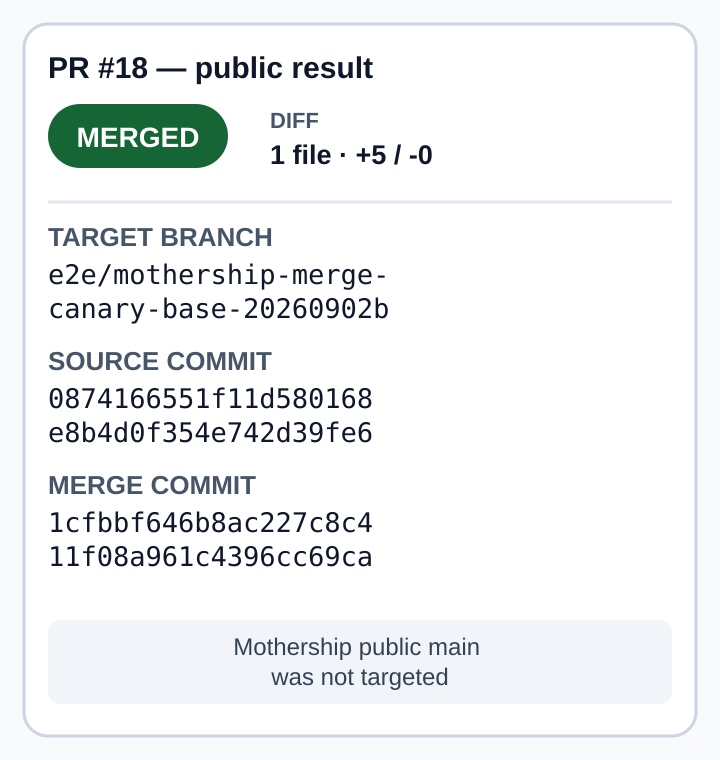

# Mothership

> This is an unreleased source candidate, not published v0.4.2 or live-operation proof.

[日本語](README.md) · [v0.4.2](https://github.com/UMEBOSHIISAN/mothership/releases/tag/v0.4.2) ·
[CI](https://github.com/UMEBOSHIISAN/mothership/actions)

<p align="center">
  
</p>

> Keep control of your work, even as the AI you use changes.
>
> Humans should not have to do everything.
> Nor should they hand everything over to AI.

Mothership is an open-source core implementation for sharing work between humans
and AI. It freezes the operation to be entrusted in advance and binds it to a
human decision.
It treats decisions, authority use, execution reports, and independent result
verification as separate records.

The focus is **a handoff another AI or person can read without confusing what
was entrusted, what was reported, what was independently checked, and what
remains unknown**. Per-action approvals and signed receipts already exist in
other OSS. Mothership reuses host approval interfaces and execution environments
and concentrates on this handoff and its interpretation. The
[ecosystem comparison (2026-10-13)](docs/ecosystem-position.md) records overlapping
capabilities, composition boundaries and current limits.

An explicit hand-off is a record, not a portable live Authority session. A live
session remains process-owned; copying or restoring a record does not restore
that session or its authority.

With GitHub PR merging as its first reference example, the current implementation
provides operation freezing, decision matching, and one-time authority consumption
within the same trusted local ledger history.

## Read a result

Separate the executor report, independent observation, unknowns and next checks.
These three examples show why a success label or exit code alone is not completion.

<p align="center">
  <picture>
    <source media="(prefers-reduced-motion: reduce)" srcset="assets/readme/en/saved-result-reading-poster.png">
    <source media="(max-width: 600px)" srcset="assets/readme/en/saved-result-reading-poster.png">
    
  </picture>
</p>

An illustration of cases 02, 03 and 06, not proof of real GitHub activity, human
approval, current external state or Harness acceptance. The static poster covers
the same cases. [Try the existing six cases](examples/saved-results/README.en.md).

<details>
<summary>Read the synthetic bundle excerpt: approval, authority use, report and observation</summary>

Read a retained record as a set of separate claims. A recorded approval and
authority use do not by themselves establish an external effect; a `SUCCESS`
Receipt without Verification remains executor-reported success only.

The following is a **synthetic formatter excerpt from current main**. It is
included to show the reading boundary; it is not an actual operation or
external proof.

```text
provided records (caller-reported)
approval: recorded (approve)
authority use: recorded (consume event in provided records)
receipt: SUCCESS (executor report; independent confirmation is separate)
verification: missing
missing: verification
conclusion: executor-reported success only
inspection scope (structural only)
provenance: caller-attested
source: source-unverified
authority: false (this inspection grants no execution permission)
source authenticated: false
external effect verified: false (this inspection does not observe external state)
next read-only check: inspect an existing independent Verification record for this action, if one exists
recovery: no re-execution; no reconsume
```

Keep the retained input unchanged. If an independent Verification record for
the action already exists, inspect it as the next read-only check. Do not infer
absence from a missing record, and do not re-execute or reconsume from this
excerpt.

</details>

## Quick start

Choose the reader for the retained format. Keep missing records missing; no conversion is needed.

| What you received | Entry | What it explains |
| --- | --- | --- |
| Saved `result.jsonl` | `inspect-result --human` | Report, Receipt, observation and missing records |
| Exported evidence bundle | `inspect --human` | Supplied request, decision, consume and result binding |
| Local Harness candidate | [Handoff guide](docs/thin-harness-handoff.md) | Synthetic result return and reread |

Reading grants no execution authority. The Harness candidate retains bundles,
which are different from the reference consumer's `result.jsonl`.

On 2026-10-24, three wheels built from pinned sources and a dedicated Harness
prefix passed the existing four cases and three input-read regressions on macOS
arm64 / Python 3.12.14. Separate-process inspection preserved the saved evidence
bytes. See the [installed revisions and scope](docs/thin-harness-handoff.md#installed-offline-check-2026-10-24).
These are synthetic offline measurements, separate from live canary, human
acceptance and public-mirror qualification.

### Read an existing result

Read an already-retained evidence bundle first with
`mothership-evidence inspect --human < existing-bundle.json`. The input must
already exist; this command does not create or fetch a bundle. An absent file
does not prove that an operation or verification never occurred.

The optional three-package source-candidate setup is described in
[Try the current candidate](docs/host-adapters.md#try-the-current-candidate).
Reading retained results requires the Core, companion, and adapters from that
same-checkout setup. It is opt-in and does not by itself qualify a live host or
external effect.
That recipe pins the complete SHA for `fd8d4f0` and installs three locally built
wheels into a fresh venv, including v1 and expected-digest reader support.
Historical reproduction pins remain separate.

The reference consumer's `--save-result` writes a different format: `result.jsonl`.
In this reader source candidate, use
`mothership-evidence inspect-result --human < result.jsonl`.
It separates the supplied execution summary, Receipt and recorded independent
observation; approval and consume are shown as not supplied by this format.
It never invents a request or missing Receipt, or follows paths inside the input.

<details>
<summary>Format compatibility, expected digests, rejection details and Node diagnostics</summary>

New saved output from this checkout carries action IDs and digests on execution
and verification reports, so reports labelled for another action are rejected.
Legacy files remain readable with positional-only summary linkage. Matching IDs
do not authenticate origin or prove completion. New output needs the matching
updated reader; see the [format compatibility table](docs/host-adapters.md#saved-result-format-compatibility).
If the recipient separately retained the intended action digest from the original
task or review, use `inspect-result --human --expect-action-sha256 "$expected_action_sha256" < result.jsonl`.
A different action or missing action identity is rejected without a summary.
Use the previously retained value, not one extracted from the file being checked.
A match preserves UNKNOWN and does not authenticate origin, freshness or records
substituted within the same action. See [expected-operation checking](docs/host-adapters.md#check-the-expected-operation).
To see only a fixed rejection reason and a next read-only check, opt in to
`--explain-error` from the same updated source candidate and keep stderr
separate from stdout:

Command: `mothership-evidence inspect-result --human
--expect-action-sha256 "$expected_action_sha256"
--explain-error < result.jsonl 2> rejection.json`

When stderr is writable on rejection, `rejection.json` contains one JSON line with the fixed schema
`mothership.saved-result-rejection.v0`. It reports only the fixed `code`,
`next_read_only_check`, `accepted_result: false`, `authority: false`,
`source_authenticated: false`, `external_effect_verified: false`, and
`recovery: "no re-execution; no reconsume"`; it does not disclose input
identity, digests, paths or raw exception text. Rejection remains exit `2`
without an accepted result; discard any partial stdout. Accepted stdout/stderr,
default JSON/`--human` output and status meanings are unchanged. This option
is added only by this updated unreleased source candidate; it is not in the
existing `fd8d4f0`, `f9ef944` or `91f474e` pins or published releases. Keep
those pins and the six-case guide's inputs and procedure unchanged.
The [six retained recipient cases and guide](examples/saved-results/README.en.md)
let a recipient read synthetic saved inputs with a pinned reader, without running
the producer. Check the separate answer key only after recording responses.
See the [same-checkout offline save-to-reader example](docs/host-adapters.md#saved-reference-results).
V1 and the expected-digest option are not in published distributions or the
six-case recipient guide's historical runtime pin.

The updated Python owner and Node client from the same checkout can explicitly
forward stop diagnostics with `sessionDiagnostics: true`. See the
[synthetic terminal example and compatibility rules](docs/host-adapters.md#node-session-diagnostics).
The default remains the legacy error format. The PR #45/#49 pins do not include
Node forwarding; this does not qualify OpenClaw/Lobster UI forwarding or
live operation.

</details>

### Try the Core boundary offline

Use Python 3.12 or newer and a source checkout of this repository. Follow the
[clone instructions](docs/installation.md#clone-first-install), then run the
marked Core walkthrough from the repository root. The marked block installs the
Core package only; `python -m pip install .` does not install the optional `mothership-evidence` CLI or adapters.
Use the three-package setup above when you need to read retained results.

<!-- quickstart:start -->
```sh
python3 -m venv .venv
. .venv/bin/activate
python -m pip install .
python examples/authority_core_walkthrough.py
mothership verify
```
<!-- quickstart:end -->

`python examples/authority_core_walkthrough.py` runs without network access or credentials.
It shows exact action freeze, derived display, a synthetic approval fixture, one consume,
and rejection of a second consume. It is not a human approval
ceremony or identity-authentication flow; it does not change GitHub or start an executor or verifier.

`mothership verify` checks bundled resource inventory, schemas, registry,
fixtures, and digests offline. It does not check the host, external safety,
or every installed byte.

`mothership demo` is the legacy 0.2 synthetic protocol-composition demo.
It is not Authority Core proof, agent execution, human approval, or evidence
that a real task completed. It is not the current Authority Core onboarding path.

## Current limitations

It is not an AI chat app or a complete business system. Model execution, human
identity authentication, business-system connections, and the processes that
execute actions and verify results must be configured separately.
It does provide explicitly invoked, read-only GitHub observation commands.
The [portable action review API](docs/action-review.md) lets each host entry path
bind the same action, expiry, and host context; the [integration catalog](docs/integrations.md)
records the implementation, local checks, and qualification limits for eight
bounded routes. The [host adapter guide](docs/host-adapters.md) shows the
same-checkout setup and exact method seams.

| Area | Implemented in the source candidate | Not implemented or certified |
| --- | --- | --- |
| identity | caller-attested decisions | human identity authentication |
| decision events | multiple events per action | one terminal decision, supersession, or revocation |
| consume | one consume per action in one trusted ledger history | no global replay prevention across copied ledgers |
| action scope | five exact `github.merge_pr` parameters | base-commit binding or arbitrary operations |
| expiry | Core TTL and portable request expiry binding | `expires_at` in action digest or host revocation fence |
| portable review | canonical action/expiry/host-context binding | effect enforcement, lease/revocation, durable resume |
| execution | separate-executor data plus opt-in Receipt adapter | no Core executor, credentials, retry, daemon, or callback |
| verification | Receipt/Verification binding plus opt-in read-back | no verifier/human identity, external truth, or read-only authentication |
| package check | bundled inventory and digest checks | host, all installed code, or external safety |
| public result | one bounded PR #18 result | generic safety, production readiness, or private-trace reproducibility |

This reference implementation is not certified for production or regulated
high-stakes deployment. One-use enforcement is scoped to one trusted local
ledger history.

## Current reference profile

The first current reference profile is `github.merge_pr`.
It is not the identity or full intended use of Mothership. It is the first
concrete example that closes the five execution parameters, decision check,
ledger record, and one-use consume boundary.

The current profile fixes:

- repository
- pull request number
- expected head SHA
- expected base branch name
- merge method

The base commit SHA is not bound. `expires_at` is not included in the action digest,
but it is included in the portable review request digest with host context. That
request digest is correlation, not a signature.
Integrations must issue a fresh `action_id` for every freeze. They must correlate
the response to the exact live issuance and displayed expiry, and reject delayed
or reused responses.

## Responsibility split

UME-HARNESS turns human intent into a bounded local-work preview.
Mothership binds a human decision to bounded authority for one external action.

<p align="center">
  
</p>

The thin Harness candidate keeps request preview and uses host-native work control.
An [explicit local handoff](docs/thin-harness-handoff.md) connects real Git observation,
exact operation review, the existing Session, separate readback, a foreground result
and offline reread. Its default uses synthetic interpretation and transports.
The updated source also has an
[explicit GitHub live entry](docs/thin-harness-handoff.md#explicit-live-github-entry),
with same-credential account/permission observation, exact foreground review, one
attempt and separate readback. This unreleased addition is absent from older pins;
it adds no custom Lease and claims no live canary or human acceptance.
The supplemental bridge passes local lease observations only and remains
a historical compatibility route; the current public releases have no
automatic runtime bridge.
The optional GitHub companion provides execution, receipt conversion,
and an opt-in read-back Verification producer. Transport and the actual effect
boundary remain separately configured; Verification remains a record separate from Receipt.

## PURPOSE

Sharing work between humans and AI requires separating what a system can do
from what it may do. Mothership exists to make that handoff explicit so a
human can entrust concrete work without surrendering all control.

| Distinction | Meaning |
| --- | --- |
| Capability | what an AI or tool can do |
| Authority | which part it may do |
| Decision | what a human chose to entrust this time |
| Execution | what operation actually occurred |

Security is not the product category. It is a condition for keeping those
responsibilities distinct.

## How the current Mothership Core works

<p align="center">
  <picture>
    <source media="(prefers-reduced-motion: reduce)" srcset="assets/readme/en/mothership-flow-poster.png">
    <source media="(max-width: 600px)" srcset="assets/readme/en/mothership-flow-poster.png">
    
  </picture>
</p>

This explanatory diagram shows the unreleased source candidate, not execution evidence.
It separates execution-route review requests, Core, the optional companion, Receipt
adapter and independent verification from read-only inspection of saved results.
Not all eight host/evidence routes review or execute an operation.
Reduced-motion settings and screens up to 600px use the equivalent vertical static poster.

Supported parameters are frozen before a caller-attested decision is checked
against the action ID and digest and recorded. The same action ID can be
consumed once within one trusted local ledger history.

### Consuming authority is not completing the work

<p align="center">
  
</p>

Mothership validates execution reports and independent verification as separate records.
The optional adapter converts terminal attempt pairs into Receipt records, and the
companion's opt-in read-back producer creates a separate Verification. UNKNOWN is
preserved. Missing finishes are rejected. Receipt SUCCESS is not independent verification.

## Documentation

### Current source candidate: Core 0.5.0.dev0 + companion 0.3.0.dev0 + adapters 0.1.0.dev0

This source candidate contains unreleased Core `0.5.0.dev0`, which
preserves the v0.4.2 boundary and adds the portable review API, plus an optional
GitHub companion `0.3.0.dev0` that requires that exact Core version, plus the
optional same-checkout adapters package `0.1.0.dev0`. This pairing is a source
candidate; it does not update the published v0.4.2 wheel or release tag.

The current main clone includes the portable review API merged through PR #43
and the readback / inspect-sidecar functionality merged through PR #45; main
remains unreleased source. To pin the Core and companion runtime and run the
existing offline example, use the
[portable review installation](docs/action-review.md#install-the-source-candidate).
To reproduce the reviewed readback and inspect-sidecar runtime, use the
[pinned host adapter setup](docs/host-adapters.md#install-the-source-candidate-in-one-checkout).
That setup keeps the three packages in one checkout and leaves optional SDK
extras opt-in. Record the pinned runtime revision and your current checkout
revision separately.
See [candidate changes and limits](docs/option-a-candidate.md) for the source
candidate's additional scope and constraints.

Core validates the exact `github.merge_pr` parameters, freezes a `FrozenAction`,
checks a caller-attested decision, and permits one consume in a trusted live
ledger. The additive `mothership.action_review` API supplies pure request/response
validation that binds a live `FrozenAction`, expiry, and host context. It does not
write a ledger, consume authority, use a network or credential, call an executor,
or enforce a host lease or revocation at runtime.

The opt-in GitHub companion accepts only a Core-issued `FrozenAction`, exact
ledger paths, an approval event ID, and an explicit transport. After a
read-only preflight it uses Core's consume result to record an attempt and
allows at most one PUT. Recognized client failures project to `failure`; other
failures, timeouts, and contradictory responses remain
`reconciliation_required`. A missing or invalid attempt pair is rejected; there
is no retry or reconsume. Its `github-execution-attempt.v1` rows are distinct
from Core Receipt and Verification records.

The opt-in [receipt adapter](examples/github_receipt_adapter.md) projects a
validated terminal attempt pair into Core's `external-action-receipt.v0`.
It checks the caller-supplied `action_id`, `action_sha256`, and
`consume_event_id` exactly, then uses `github-attempt:<start event ID>` and
`canonical_json_sha256({"started": started, "finished": finished})` as the
observation reference. For a valid terminal pair, strong success projects to
`SUCCESS`, recognized client failure to `FAILED`, and other failure or
`reconciliation_required` to `UNKNOWN`. Missing, ambiguous, or unobserved facts
are never filled into `SUCCESS`; a missing finish or inconsistent closed pair is
rejected. The adapter grants no authority, does not authenticate or store the
records, and does not produce an independent verifier record.

Core and companion remain separate packages; adapter and read-back producer use
are opt-in, and there is no automatic cross-repository runtime bridge. See the
[action review guide](docs/action-review.md), [composition guide](docs/composition.md),
[integration catalog](docs/integrations.md), and [host adapter guide](docs/host-adapters.md)
for the API, responsibility, connection, and qualification conditions. Run the offline synthetic example from the source checkout root with
`PYTHONPATH=.:packages/mothership-github python examples/github_receipt_adapter.py`.
Its output demonstrates synthetic binding only; it performs no GitHub
operation, credential use, ledger consume, or independent external observation.

The opt-in companion `verify_merge_pr()` can produce a GitHub read-back
Verification bound to the exact Core-issued `FrozenAction` and validated
Receipt. The default path performs at most two public tokenless GETs (the pull
request and its Git Database merge commit) and retains only sanitized PR and
commit projections, UTC request boundaries, fixed reason codes, and canonical
hashes. Malformed, contradictory, or time-invalid observations remain
`UNKNOWN`; a valid wrong head, base, or merge topology is `MISMATCH`. Receipt
status never selects Verification status. The producer does not consume or
write authority, call an executor, retry, or poll. Injected opener results are
synthetic/host-attested offline evidence; they do not authenticate GitHub, an
executor, a human, or the method used to create a merge. The read-back producer
is included as an opt-in companion capability, while its Verification record
remains separate from Receipt. See the [offline read-back example](examples/github_readback_verification.md)
and [composition guide](docs/composition.md).

For a persisted bundle, the separate
`verify_recorded_merge_pr(action, receipt, *, opener=None)` entry point accepts
a plain detached action mapping and its bound Receipt as caller-attested data,
validates their digests, and reuses the same observer. It does not restore or
reissue a `FrozenAction`, use authority, call an executor, or write a ledger.
The existing `verify_merge_pr()` remains strict and still requires the live
Core-issued `FrozenAction`. The adapters' `mothership-evidence readback`
command is the explicit CLI route for this persisted path; `export`, `inspect`,
`inspect --human`, and MCP remain offline.

### Handle one GitHub PR

The source-checkout [reference consumer](examples/github_merge_reference.md)
displays the exact action, records an explicit approval, and executes once.
Add `--verify-result` to build the Receipt and perform independent public GitHub
read-back in the same process. Execution success and confirmation remain separate;
unknown results never trigger automatic retry. The operator selects the target PR,
enters a token manually, and approves the displayed action in the terminal.
Also add `--save-result` to retain the frozen action, execution report, and
independent verification in `result.jsonl` inside the ledger directory. Tokens
are excluded and existing files are never overwritten. Save failures return an
error; partial records are not completion evidence and never trigger a retry.
Initial PR-fetch failures report a bounded HTTP or network/response category
without credentials or raw exception text. See the
[preflight diagnostic guide](examples/github_merge_reference.md#diagnose-an-initial-preflight-stop).

### Read the result of a task

With the optional adapters installed from the same checkout, pass an existing
evidence bundle on stdin to `mothership-evidence inspect --human`. It separates
recorded approval, recorded authority use, the execution report, independent
Verification, and missing evidence. A SUCCESS Receipt without a Verification
record is not presented as independently confirmed. For a Verification
produced by this readback producer, the formatter displays its escaped
`observed_state.summary`, which contains an allowlisted fixed reason and
bounded explanation. Existing or caller-supplied Verification summaries are
treated as arbitrary caller-reported display data; the formatter does not
parse prose into a trusted structured reason or authenticate its source. The
complete read-back evidence remains a caller-retained sidecar referenced by
the Verification hash.
Explicitly supplying that retained sidecar checks its canonical hash, action
identity/digest and observed-state binding, then displays the caller-reported
reason, observation time and next read-only check:

Command: `mothership-evidence inspect --human --readback-evidence readback-evidence.json < verified.json`

This example requires an already retained `verified.json` and
`readback-evidence.json`. Inspection reads them offline and makes no network request.
The sidecar must be a bounded regular file. Invalid or mismatched input stops
with exit status 2 and no explanation. Matching records establish internal
consistency, not source authentication, causation or current remote state.
An absent record does not prove that an operation or verification never occurred.
Sources remain caller-attested / source-unverified. This local reading path does
not qualify a Dots runtime or authenticate an external effect.
See the [installation and synthetic bundle example](docs/host-adapters.md#read-only-evidence-routes).

To read back a persisted bundle, require `missing == ["verification"]`, keep the
input unchanged, and require exit status `0`. Follow the
[readback retention command](docs/host-adapters.md#read-only-evidence-routes) in the guide.

The sidecar's canonical SHA-256 must match `verified.json`'s
`verification.evidence_refs`. One invocation performs at most two public
tokenless GETs and uses no credentials, retry, polling, authority, executor,
ledger write, or external effect. Successful stderr is the sidecar data stream,
not an error log; keep stdout and stderr separate and discard both files,
including partial output, on any nonzero exit. Do not merge them with `2>&1`.

### Code tour

- [`orchestration/lib/action_authority.py`](orchestration/lib/action_authority.py) — action freeze and
  decision transport
- [ledger implementation](orchestration/lib/action_authority_ledger.py) — append and one-shot consume
- [external-action contracts](orchestration/lib/external_action.py) — Receipt and Verification records
- [`tests/test_action_authority.py`](tests/test_action_authority.py) — Authority Core boundary tests
- [ledger tests](tests/test_action_authority_ledger.py) — replay and ledger-history tests
- [external-action tests](tests/test_external_action_contracts.py) — external-action contract tests

### Origin and compatibility

This boundary carries lessons from incidents where the reviewed target changed
before execution and where an unchecked tool failure was summarized as success.
Labels are not evidence; unknown results stop.

Frontdoor, WGM, Router, and Secretary protocols remain for legacy 0.2
compatibility and history. They are not the current Authority Core path.

### References

- [Architecture](docs/architecture.md)
- [Installation](docs/installation.md)
- [Protocols](docs/protocols.md)
- [Security model](docs/security.md)
- [Composition guide](docs/composition.md)
- [Portable action review API](docs/action-review.md)
- [Integration catalog](docs/integrations.md)
- [Host adapter guide](docs/host-adapters.md)
- [0.2 compatibility history](docs/legacy/compatibility-0.2.md)
- [日本語README](README.md)

## HISTORICAL BASELINE: v0.4.2

Published v0.4.2 was a docs-only release and remains the historical public
baseline. This source candidate retains its Authority Core contracts,
updates the documentation and imagery, and adds the unreleased portable review API.

Published v0.4.2, the historical public baseline, freezes one supported external operation, checks a
caller-attested human decision, records it in a local ledger, and permits one
consume.

Implemented:

- validation and freezing of supported parameters into a `FrozenAction`
- approve/reject checks against the action ID and digest
- local recording of decision events
- one consume in the same trusted local ledger history
- closed contracts that separate an executor Receipt from Verification

Not shipped in v0.4.2:

- an automatic UME-HARNESS runtime bridge
- a general executor, verifier producer, credential manager, retry, or daemon
- human identity authentication
- arbitrary operation profiles or autonomous execution

Proposal and evidence are decision context, but they were not mechanically bound to a FrozenAction in v0.4.2.
Mothership receives the supported execution parameters separately and freezes them first.
Human identity is not authenticated.

**Changes in v0.4.2 (historical public baseline)**

The README image-generation dependency changes from Pillow 11.3.0 to 12.3.0.
The Japanese and English GIFs and static posters are regenerated, with matching
`SHA256SUMS` entries. Diagram meaning, Authority Core behavior, and authority
boundaries are unchanged. Pillow is needed only for image generation and is not
added as a Mothership runtime dependency. An offline Authority Core walkthrough
was added to the source documentation. Runtime Authority Core behavior, approval-acceptance
conditions, and the supported operation profile are unchanged from v0.4.1.

**Additions in the 0.5.0.dev0 source candidate**

`build_review_request()` and `validate_review_response()` provide a pure portable
review seam. The response is checked against the host-retained original request
and live `FrozenAction`; expiry or host-context drift stops before approval or
rejection is accepted. This is not an effect-time revocation fence, durable
resume mechanism, host adapter, or human identity authentication.

The offline Authority Core walkthrough was added after v0.4.1; it is not
included in the v0.4.1 tag or wheel, and it is not included in the v0.4.2
wheel either. It is a source-checkout-only example.

## One public result

The [bounded public result for PR #18](docs/evidence/github-merge-pr-e2e-20260903/README.md)
records one `github.merge_pr` against an isolated canary base. Public GitHub
read-back shows the target head SHA, merge commit, parents, and bounded diff size.

<p align="center">
  
</p>

This is one public result for PR #18. It does not claim that the private
lifecycle is reproducible from public material, generic safety, or production suitability.

## License

The project code is MIT; see [LICENSE](LICENSE). The bundled Noto Sans JP font
used to generate README assets remains under the
[SIL Open Font License 1.1](assets/readme/source/fonts/OFL-1.1.txt).
