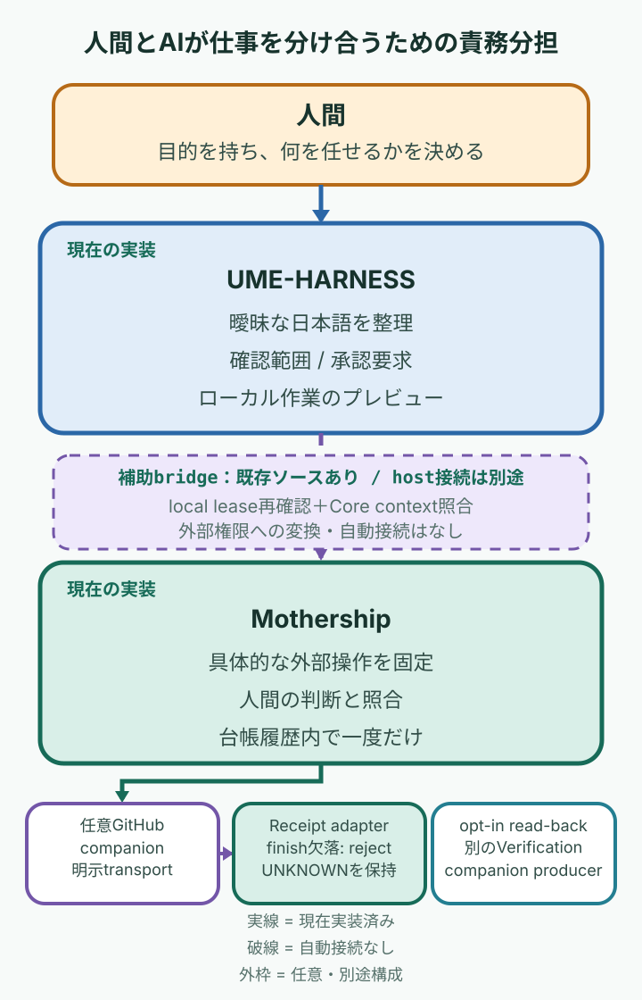
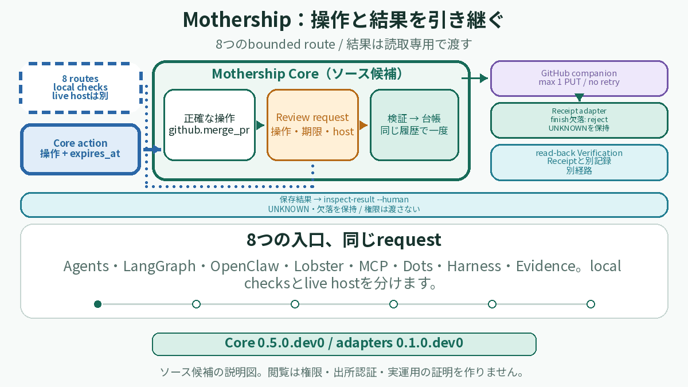
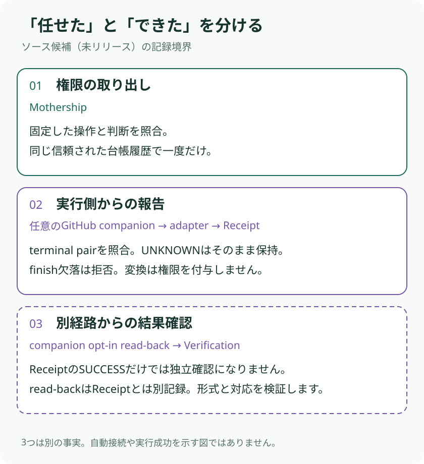
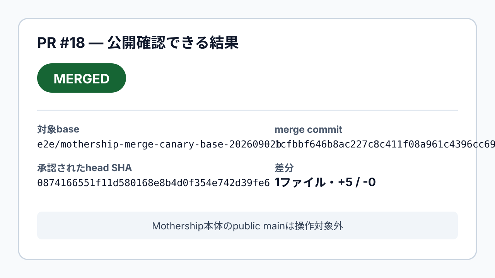

# Mothership

> 未リリースのソース候補です。公開済みv0.4.2や実運用の証拠ではありません。

[English](README.en.md) · [v0.4.2](https://github.com/UMEBOSHIISAN/mothership/releases/tag/v0.4.2) ·
[CI](https://github.com/UMEBOSHIISAN/mothership/actions)

<p align="center">
  
</p>

> 使うAIが変わっても、仕事の主導権は手元に。
>
> 人間が全部を抱えず、AIにも全部を明け渡さない。

Mothershipは、人間とAIが仕事を分け合うために、任せる操作を事前に固定し、
人間の判断と結び付ける、オープンソースの中核実装です。
判断・権限の使用・実行報告・独立した結果確認を、それぞれ別の記録として扱います。

伸ばしているのは、**別のAIや担当者に引き継いでも、「何を任せたか」「何が報告されたか」
「何が独立確認され、何がまだ不明か」を取り違えずに読めること**です。
操作別の承認や署名付きReceiptには既存OSSがあります。Mothershipは既存hostの承認UI・
実行環境を活用し、この受け渡しと結果の読み取りに集中します。
[類似OSS・標準との責務比較（2026-10-13）](docs/ecosystem-position.md)に、重なる機能と制約を整理しています。

現在の参照対象はGitHub PRのマージ（`github.merge_pr`）です。管理するのは構成した操作経路です。
引き継ぐのは判断材料と操作の記録です。liveな `MergeReviewSession` はプロセスに所属し、
コピー・復元できません。記録の共有が、別の担当への実行権限の移送を意味することはありません。

## 結果の読み方

たとえば、`example/repo` のPR #7について、承認・consume・実行成功の記録があり、
独立確認の記録はまだないとします。現行の `inspect --human` に合成bundleを渡した出力の抜粋です。
実際のGitHub操作や出所認証を示すものではありません。

```text
provided records (caller-reported)
approval: recorded (approve)
authority use: recorded (consume event in provided records)
receipt: SUCCESS (executor report; independent confirmation is separate)
verification: missing
missing: verification
conclusion: executor-reported success only
inspection scope (structural only)
provenance: caller-attested
source: source-unverified
authority: false (this inspection grants no execution permission)
source authenticated: false
external effect verified: false (this inspection does not observe external state)
next read-only check: inspect an existing independent Verification record for this action, if one exists
recovery: no re-execution; no reconsume
```

このbundleでは「実行側から成功報告あり、独立確認の記録は未提供」と読めます。
記録がないことは、独立確認が行われなかった証拠ではありません。
`SUCCESS`だけで確認済みと扱わず、対応する既存の独立確認記録があれば、その対応を確認します。
記録同士の整合性を調べることと、記録の発生元や現在の外部状態を認証することは分けて扱います。
実際の公開結果は、後半の[PR #18の一例](#公開結果の一例)に分けています。

## クイックスタート

### 保存済みの結果を読む

最初の読み取り経路は、呼出し元が保持・exportした既存の記録をターミナルで読む方法です。
Python 3.12以上と、同じcheckoutのCore・companion・adaptersが必要です。
[host adapter guideの現行候補setup](docs/host-adapters.md#try-the-current-candidate)で、
使う版を固定して3パッケージを導入してください。

コマンド: `mothership-evidence inspect --human < existing-bundle.json`

`existing-bundle.json`は、呼出し元がすでに保持・exportしたevidence bundleです。
このコマンドがファイルや実行記録を生成するわけではありません。
閲覧はオフラインで、承認・実行・権限の再使用を行いません。欠けている記録は欠落のまま扱います。
sidecarの照合や明示的なreadbackは、[詳しい読み取り手順](#結果閲覧と明示的なreadback)を参照してください。

参照consumerの`--save-result`で保存した`result.jsonl`は別形式です。このreaderのソース候補では、
`mothership-evidence inspect-result --human < result.jsonl`で読みます。
保存された実行報告・Receipt・独立観測を分け、承認やconsumeは「この保存形式には未提供」と表示します。
requestや欠けたReceiptを後付けせず、入力内のpathも読み込みません。
[保存物を受け取る人向けの6ケースと手順](examples/saved-results/README.md)では、
producerを動かさずに、合成の保存物を固定readerで読めます。正答表は回答後に照合します。
[同一checkoutでの保存→閲覧のオフライン例](docs/host-adapters.md#saved-reference-results)を参照してください。
この追加は公開済み配布物や、ガイドの過去の固定revisionには含まれません。

更新した同一checkoutのPython ownerとNode clientでは、`sessionDiagnostics: true`を
明示すると、停止段階・不明点・次の確認先をNode側でも読めます。
[合成ターミナル例と互換性](docs/host-adapters.md#node-session-diagnostics)を参照してください。
既定は従来のエラー形式です。過去の固定revisionにはこの追加はなく、OpenClaw／Lobsterの
画面への転送や実運用の受入を示すものではありません。

### Coreの境界をオフラインで試す

Python 3.12以上とソースcheckoutを使い、[clone手順](docs/installation.md#clone-first-install)で取得した
リポジトリのルートで実行してください。次の手順はCoreだけを導入するオフライン例です。
上の結果閲覧には、別途adaptersを含む3パッケージのsetupが必要です。

<!-- quickstart:start -->
```sh
python3 -m venv .venv
. .venv/bin/activate
python -m pip install .
python examples/authority_core_walkthrough.py
mothership verify
```
<!-- quickstart:end -->

`python examples/authority_core_walkthrough.py`は、外部通信や認証情報を使わず、
操作の固定、表示の導出、合成した承認記録、一度だけのconsume、二度目の取り出し拒否を確認します。
これは人間の承認ceremonyや本人認証ではありません。GitHubを変更せず、executorや確認系も起動しません。

`mothership verify`は、同梱resource inventory、schema、registry、fixture、digestを
オフラインで検査します。host、外部環境、インストール済みの全コードの安全性を検査するものではありません。

`mothership demo`はlegacy 0.2のsyntheticなprotocol-composition demoです。
Authority Coreの証明でも、agent実行、人間の承認、実タスク完了の証拠でもありません。
現在のAuthority Coreを体験する入口ではありません。

## 現在の制約

AIチャットアプリや完成済みの業務システムではありません。
モデル実行、本人認証、業務システムへの接続、実行・結果確認の処理は別途構成します。
明示的に呼び出す読み取り専用のGitHub観測CLIは提供します。
各host entry pathが同じ操作・期限・host contextを照合する
[portable action review API](docs/action-review.md) と、8つのbounded routeの
実装・local checks・qualification limitを整理した
[integration catalog](docs/integrations.md)、実装方法をまとめた
[host adapter guide](docs/host-adapters.md) を追加しています。

| 項目 | source candidateで実装していること | 実装・認証していないこと |
| --- | --- | --- |
| identity | caller-attested decisionを保持 | 人間の本人確認は行いません |
| decision event | 同じactionへ複数のdecision eventを記録できる | 一つのterminal decision、supersede、revoke |
| consume | 同じaction IDは同じ台帳履歴内で一度だけconsumeできる | コピー・復元した台帳をまたぐglobal replay防止 |
| action scope | `github.merge_pr`の5つのexact parameterを固定 | base commit SHAのbind、任意operation |
| expiry | CoreのTTLを検査し、review requestでは期限もdigestへbind | action digestへの期限bind、host側の失効fence |
| portable review | action・expiry・host contextをrequest/responseへcanonicalにbind | 実際のeffect境界、lease/revocation、永続resume |
| execution | 別executor向けdata、companionのattempt/Receipt adapter | Core内のexecutor、credential、retry、daemon、callback |
| verification | Receipt/Verificationのshapeとbinding、read-back producer | verifier、人間identity、外部真実、read-only認証 |
| package check | 同梱inventoryとdigestを検査 | host、全インストールコード、外部安全性 |
| public result | PR #18のbounded result | generic safety、production readiness、private trace再現性 |

本実装は、本番運用または規制対象の高リスク用途への適合を認証するものではありません。
一回限りの再利用拒否は、ひとつの信頼されたローカル台帳履歴に限られます。

## 現在の参照profile

最初のcurrent reference profileは `github.merge_pr` です。
これはMothershipの用途全体ではなく、5つの実行パラメータの固定、判断との照合、
台帳記録、一回限りのconsume境界を具体化した最初の実装例です。

現在固定する値:

- repository
- pull request number
- expected head SHA
- expected base branch name
- merge method

base commit SHAは結び付けられません。`expires_at`はaction digestに含まれませんが、portable review requestの
digestには期限とhost contextが含まれます。request digestは署名ではなく相関値です。
統合側は毎回新しい `action_id` を発行し、表示した発行情報と期限へ応答を対応付け、
遅延または再利用された応答を拒否してください。

## 責務分担

UME-HARNESSは、人間の意図を範囲の見えるローカル作業案へ整理します。
Mothershipは、人間の判断をひとつの外部操作に対する限定Authorityへ結び付けます。

<p align="center">
  
</p>

これは責務分担の方向を示す図です。補助bridgeはlocal lease観測をCore contextへ渡すだけで、
現在の公開版同士に自動接続はありません。
任意GitHub companionは実行、receipt変換、opt-inのread-back Verification producerを担います。
transportと実際のeffect境界は別途構成し、VerificationはReceiptとは別の記録として扱います。

## PURPOSE

人間とAIが仕事を分け合うには、「できる」と「やってよい」を分ける必要があります。
Mothershipは、AIを止めることではなく、人間が具体的な仕事を安心して任せられるように、
その受け渡しを曖昧にしないことを目指します。

| 区別 | 意味 |
| --- | --- |
| Capability | AIやツールに何ができるか |
| Authority | そのうち何をしてよいか |
| Decision | 人間が今回どこまで任せると決めたか |
| Execution | 現実にどの操作が行われたか |

安全性は製品カテゴリーではなく、これらを混ぜずに扱うための成立条件です。

## 現在のMothership Core

<p align="center">
  <picture>
    <source media="(prefers-reduced-motion: reduce)" srcset="assets/readme/ja/mothership-flow-poster.png">
    <source media="(max-width: 600px)" srcset="assets/readme/ja/mothership-flow-poster.png">
    
  </picture>
</p>

これは未リリースのソース候補の仕組みの図解です。8つのhost/evidence routeから共有するreview request、Core、
任意companion、receipt adapter、別経路の独立確認、保存結果の読取専用の引継ぎを区別しています。
local checksの説明であり、GIFそのものは実行証拠ではありません。
動きを抑える設定または600px以下の画面では、同じ意味の縦型静止ポスターを表示します。

対応済みの実行パラメータを固定してから、人間の判断として渡された応答を
action IDとdigestへ照合し、判断eventを記録します。同じaction IDのconsumeは、
ひとつの信頼されたローカル台帳履歴内で一度だけです。

### 権限の取り出しと、仕事の完了は別

<p align="center">
  
</p>

Mothershipは実行報告と独立確認の記録を分けて検証します。
任意adapterはterminal attempt pairをReceiptへ変換し、companionのopt-in read-back producerは別のVerificationを作ります。
UNKNOWNを保持します。
finish欠落は拒否します。ReceiptのSUCCESSだけでは独立確認になりません。

## 詳細ドキュメント

### コードツアー

- [`orchestration/lib/action_authority.py`](orchestration/lib/action_authority.py) — 操作の固定と判断の照合
- [ledger implementation](orchestration/lib/action_authority_ledger.py) — 台帳への追記と一回限りの使用
- [external-action contracts](orchestration/lib/external_action.py) — 結果報告と独立確認の記録形式
- [`tests/test_action_authority.py`](tests/test_action_authority.py) — Authority Coreの境界テスト
- [ledger tests](tests/test_action_authority_ledger.py) — 再利用と台帳履歴のテスト
- [external-action tests](tests/test_external_action_contracts.py) — 外部操作の記録形式のテスト

### current source candidate: Core 0.5.0.dev0 + companion 0.3.0.dev0 + adapters 0.1.0.dev0

このソース候補には、v0.4.2の境界を保持してportable review APIを加えた
未リリースのCore `0.5.0.dev0`、それに厳密に依存する任意導入のGitHub companion
`0.3.0.dev0`、および同じcheckoutで利用する任意導入のadapters
`0.1.0.dev0`が含まれます。この組み合わせは候補の対応関係であり、公開済みv0.4.2の
wheelやrelease tagを更新したものではありません。

Coreは `github.merge_pr` のexact parameterを検証して `FrozenAction`へ固定し、
caller-attestedな判断を照合して、信頼されたlive ledgerで一度だけconsumeします。
加えて `mothership.action_review` は、live `FrozenAction`、期限、host contextを
共有する純粋なrequest/response検証を提供します。ledger書込み、consume、network、credential、
executor callback、host runtimeのlease/revocation強制は行いません。

GitHub companion（opt-in）は、Core発行の `FrozenAction`、厳密な台帳path、approval event ID、
明示transportだけを受け付けます。read-only preflight後にCoreのconsume結果を使ってattemptを記録し、
最大1回のPUTを試みます。認識済みのclient failureは `failure`、その他のfailure・timeout・矛盾した応答は
`reconciliation_required` として保持されます。finish欠落など不完全なpairはadapterがrejectし、retryや
reconsumeは行いません。companionの `github-execution-attempt.v1` はCoreのReceipt/Verificationとは別です。

opt-inの[receipt adapter](examples/github_receipt_adapter.md)は、検証済みterminal attempt pairを
Coreの `external-action-receipt.v0` へ投影します。callerが渡す `action_id`、`action_sha256`、
`consume_event_id` を正確に照合し、`github-attempt:<start event ID>` と
`canonical_json_sha256({"started": started, "finished": finished})` を証拠参照に使います。
validなterminal pairでは、強いsuccessは `SUCCESS`、認識済みclient failureは `FAILED`、その他のfailureと
`reconciliation_required`は `UNKNOWN` へ投影されます。欠落・曖昧・未観測の値を `SUCCESS` に補完せず、finish欠落や
不整合pairはrejectされます。adapterはauthorityを付与せず、記録を認証・保存せず、独立したverifier recordも生成しません。

Coreとcompanionは別packageで、adapterとread-back producerの利用はopt-inです。自動runtime bridgeや
別repo間の自動接続はありません。portable review APIの使い方は [action review guide](docs/action-review.md)、
責務と接続条件は [composition guide](docs/composition.md)、8つのhost/evidence routeは
[integration catalog](docs/integrations.md) と [host adapter guide](docs/host-adapters.md) に整理しています。
オフラインの合成例は、source checkoutのルートで
`PYTHONPATH=.:packages/mothership-github python examples/github_receipt_adapter.py` を実行してください。
出力は合成recordのbinding確認であり、GitHub操作、credential、ledger consume、独立した外部確認を示しません。

companionのopt-in `verify_merge_pr()` は、Coreが発行した正確な `FrozenAction` と検証済みReceiptへ結び付いた
GitHub read-back Verificationを生成できます。既定経路は公開tokenless GETを最大2回（PRとGit Databaseのmerge commit）だけ行い、
PRとcommitのサニタイズ済みprojection、UTCの取得境界、固定reason code、canonical hashだけを保持します。
不正・矛盾・時刻不整合は `UNKNOWN`、対象head・baseまたはmerge topologyの有効な不一致は `MISMATCH` として残り、
ReceiptのstatusはVerificationを選びません。authority/ledgerのconsumeや書込み、executor呼出し、retry、pollingは行いません。
注入openerの結果はsynthetic/host-attestedなオフライン証拠であり、GitHub・executor・人間・merge方法の認証ではありません。
詳しくは [offline read-back example](examples/github_readback_verification.md) と
[composition guide](docs/composition.md) を参照してください。read-back producerはcompanionに
含まれるopt-in機能ですが、Receiptとは別経路のVerificationを作るもので、人間やGitHubの認証ではありません。

保存済みbundleを読むための別入口として
`verify_recorded_merge_pr(action, receipt, *, opener=None)` も提供します。これは
plainなdetached action mappingと結び付いたReceiptをcaller-attestedな記録として検証し、
同じ観測処理を使います。`FrozenAction`の復元・再発行、Authorityの使用、ledgerやexecutorへの呼出しは
行いません。既存の `verify_merge_pr()` は引き続きliveなCore-issued `FrozenAction`を要求します。
adaptersの `mothership-evidence readback` は、この保存済み入口を明示的に選ぶCLIです。
`export`、`inspect`、`inspect --human`、MCPはofflineのままです。

[候補の変更と制約](docs/option-a-candidate.md)。

### 導入する版と検証範囲

Python 3.12以上と、このリポジトリのソースcheckoutが必要です。
まず[clone手順](docs/installation.md#clone-first-install)で取得し、リポジトリのルートで実行してください。
公開済みv0.4.2は歴史的な公開ベースラインです。現在のmain cloneには、PR #43のportable review APIと
PR #45のreadback / inspect-sidecar機能が含まれます。mainも未リリースのソースです。
Coreとcompanionだけのruntimeを固定して既存のオフライン例を実行する場合は、
[portable review APIの導入手順](docs/action-review.md#install-the-source-candidate)を
参照してください。readback / inspect-sidecarのレビュー済みruntimeを固定して試す場合は、
[host adapter guideの固定setup](docs/host-adapters.md#install-the-source-candidate-in-one-checkout)を
使ってください。固定したruntimeと現在のcheckoutのrevisionを、それぞれ記録してください。


### GitHubのPRを1件扱う入口

source checkoutの[参照consumer](examples/github_merge_reference.md)で、対象の表示、
exact actionへの承認、一度だけの実行まで進められます。`--verify-result`を指定すると、
同じプロセスでReceipt生成と公開GitHubの独立read-backまで行います。
実行成功と確認済みを分けて表示し、不明な結果を自動再実行しません。
実行には対象PRの選択と端末での明示承認、手入力のtokenが必要です。
さらに `--save-result` を指定すると、操作内容・実行報告・独立確認を台帳フォルダの
`result.jsonl` に保存します。tokenは保存せず、既存ファイルは上書きしません。
保存失敗はエラーになり、途中までの記録を完了証拠と扱ったり、操作を自動でやり直したりしません。
初回のPR取得に失敗した場合は、HTTP statusや通信・応答検証の分類を秘密情報なしで表示します。
診断分類と保存範囲は[参照consumerの説明](examples/github_merge_reference.md#diagnose-an-initial-preflight-stop)を確認してください。

### 結果閲覧と明示的なreadback

任意のadaptersを同じcheckoutから導入した場合は、手元にあるevidence bundleを
`mothership-evidence inspect --human`の標準入力へ渡すと、承認の記録、権限使用の記録、
実行報告、独立確認、欠けている証拠を分けて読めます。
ReceiptがSUCCESSでも独立確認の記録がなければ、確認済みとは表示しません。
このreadback producerが生成したVerificationでは、固定reason codeとbounded explanationを含む
`observed_state.summary`をエスケープして表示します。既存またはcaller-suppliedなVerificationの要約は
任意のcaller-reported表示データとして扱い、要約文からtrustedなstructured reasonを推測したり、出所を認証したりしません。
操作の再実行は勧めません。read-backの完全な観測evidenceは、Verificationの
`evidence_refs`にあるcanonical hashと照合できるsidecarとしてcallerが保持します。
保存したsidecarも明示的に渡すと、hash・操作ID/digest・観測状態のbindingを自動照合し、
caller-reportedな理由コード、観測時刻、次の読み取り確認をまとめて表示します。

コマンド: `mothership-evidence inspect --human --readback-evidence readback-evidence.json < verified.json`

この例には、先に保存した `verified.json` と `readback-evidence.json` が必要です。
`inspect`は保存済み記録をオフラインで読み、ネットワーク通信は行いません。
入力はサイズ制限付きの通常ファイルです。不一致や不正な入力は終了コード2で停止し、説明を出しません。
一致は記録同士の整合性であり、出所認証・操作の因果関係・現在の状態の証明ではありません。
記録がないことは、操作や確認が行われなかった証明ではありません。
出所は引き続きcaller-attested / source-unverifiedです。これはローカルな読み取り経路で、
Dotsの実機受入や外部操作の実在を証明するものではありません。
保存済みbundleのread-backは、入力の `missing == ["verification"]` を検証してから、
[ガイドのreadback手順](docs/host-adapters.md#read-only-evidence-routes)で元bundleを残したまま実行します。
exit status `0`を要求し、stderrのsidecarを保持してください。

明示的に呼び出した `mothership-evidence readback` は、最大2回のpublic tokenless GETを行います。
credential、retry、polling、Authority、
executor、ledger write、external effectを使いません。成功時のstderrはerror logではなくsidecar dataです。
stdoutとstderrを分離し、`2>&1`で結合しないでください。exit statusが0以外ならpartial outputを含む
両方のファイルを破棄し、0かつcanonical hash照合に成功した場合だけ結果を保持します。
[導入・合成bundleの例](docs/host-adapters.md#read-only-evidence-routes)。

### 背景と互換性

この境界は、承認時に見た対象と実行時の対象がずれた運用事故、および未確認のtool failureを
success summaryとして扱った事故から学んでいます。labelをevidenceとして扱わず、不明なら停止します。

Frontdoor、WGM、Router、Secretaryのprotocolはlegacy 0.2互換と履歴のために残しています。
現在のAuthority Core実行経路ではありません。

### リファレンス

- [Architecture](docs/architecture.md)
- [Installation](docs/installation.md)
- [Protocols](docs/protocols.md)
- [Security model](docs/security.md)
- [Composition guide](docs/composition.md)
- [Portable action review API](docs/action-review.md)
- [Integration catalog](docs/integrations.md)
- [Host adapter guide](docs/host-adapters.md)
- [0.2互換protocolの履歴](docs/legacy/compatibility-0.2.md)
- [English README](README.en.md)

## HISTORICAL BASELINE: v0.4.2

公開済みv0.4.2（歴史的な公開ベースライン）はdocs-onlyのリリースでした。このソース候補は
そのAuthority Coreのruntime契約を保持し、文書・画像と未リリース候補のportable review APIを追加しています。

公開済みv0.4.2（歴史的な公開ベースライン）が提供したのは、ひとつの対応済み外部操作を固定し、
caller-attestedな人間の判断と照合し、ローカル台帳へ記録して一度だけ取り出す境界です。

実装済み:

- 対応済み操作パラメータの検証と `FrozenAction` への固定
- approve / rejectとaction ID・digestの照合
- decision eventのローカル台帳への記録
- 同じ信頼されたローカル台帳履歴での一回限りのconsume
- executorのReceiptと別経路Verificationを分けるclosed contract

v0.4.2当時に含まなかったもの:

- UME-HARNESSとのruntime bridge
- 汎用executor、verifier producer、credential manager、retry、daemon
- human identity authentication
- 任意operationや自動実行

proposalとevidenceは判断材料ですが、FrozenActionへ機械的に結び付けられません。
Mothershipは、対応済みの実行パラメータを別に受け取り、それを先にfreezeします。

**v0.4.2での変更点（歴史的な公開ベースライン）**

README画像の生成用依存関係をPillow 11.3.0から12.3.0へ更新しました。
日英のGIFと静止ポスターを再生成し、`SHA256SUMS`を更新しています。
図の意味、Authority Coreの機能、実行権限の扱いは変わりません。
Pillowは画像生成時だけ必要で、Mothershipの実行時依存関係には追加されません。
オフラインのAuthority Core walkthroughを追加しました。
runtimeのAuthority Core挙動、承認受理条件、対応操作profileはv0.4.1から変更していません。

**0.5.0.dev0 source candidateでの追加**

`build_review_request()` と `validate_review_response()` を使う純粋なportable review seamを追加しました。
responseはhostが保持したoriginal requestとlive `FrozenAction`へ照合され、期限切れやhost contextの変更は
approve / rejectの前に停止します。これは実行時の失効fence、永続resume、host adapter、人間の本人確認を提供しません。

### source checkoutの実行例

Coreのwalkthroughはv0.4.1公開後に追加された例で、v0.4.1タグやwheelには含まれません。
v0.4.2のwheelにも含まれません（source checkout専用の実行例です）。

## 公開結果の一例

[PR #18の公開結果](docs/evidence/github-merge-pr-e2e-20260903/README.md)は、
隔離されたcanary baseに対するひとつの `github.merge_pr` を記録した一例です。
公開GitHubのread-backから、対象head SHA、merge commit、親、対象差分量を確認できます。

<p align="center">
  
</p>

これはPR #18に限った公開結果です。非公開の全履歴を公開物だけで再現できること、
汎用的な安全性、本番運用への適合は主張しません。

## License

プロジェクトのコードはMITです。詳細は [LICENSE](LICENSE) を参照してください。
README asset生成用に同梱するNoto Sans JPは
[SIL Open Font License 1.1](assets/readme/source/fonts/OFL-1.1.txt)です。
